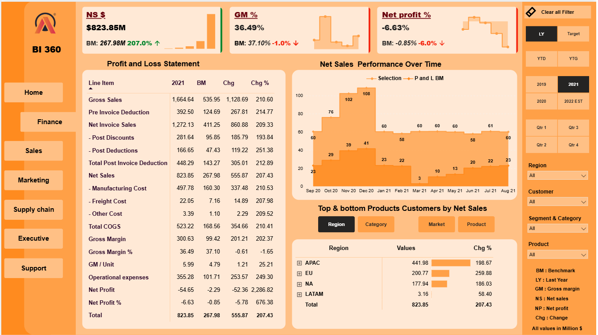
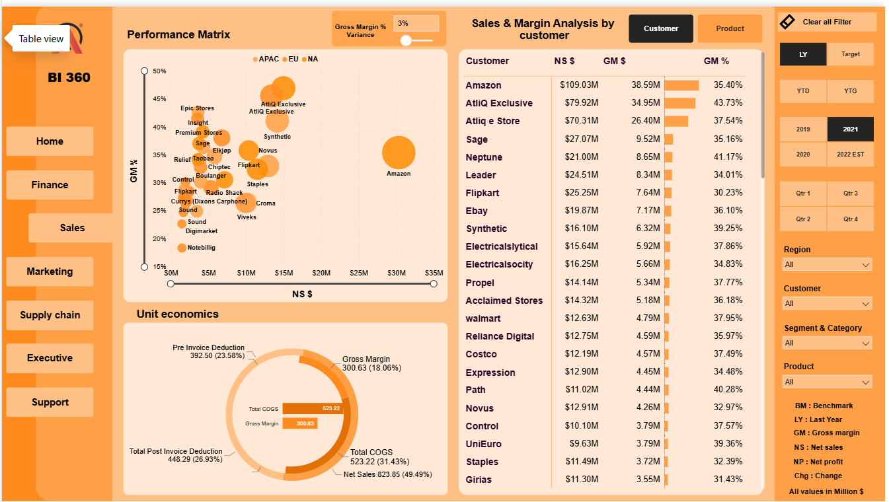
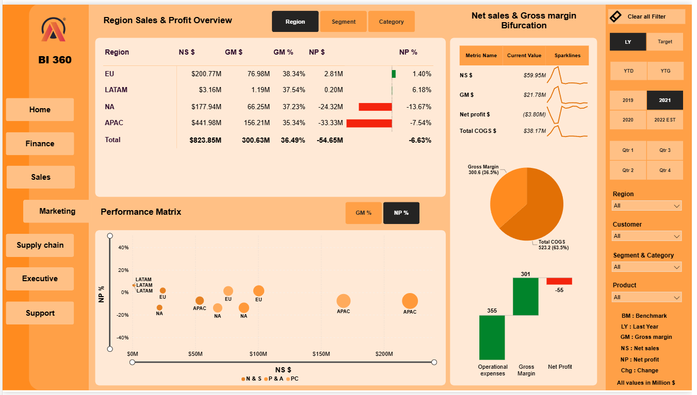
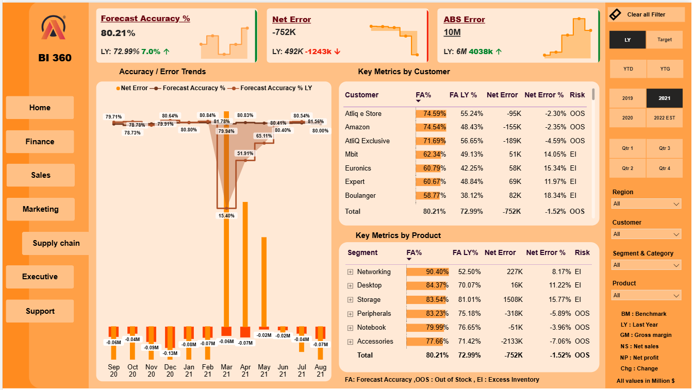
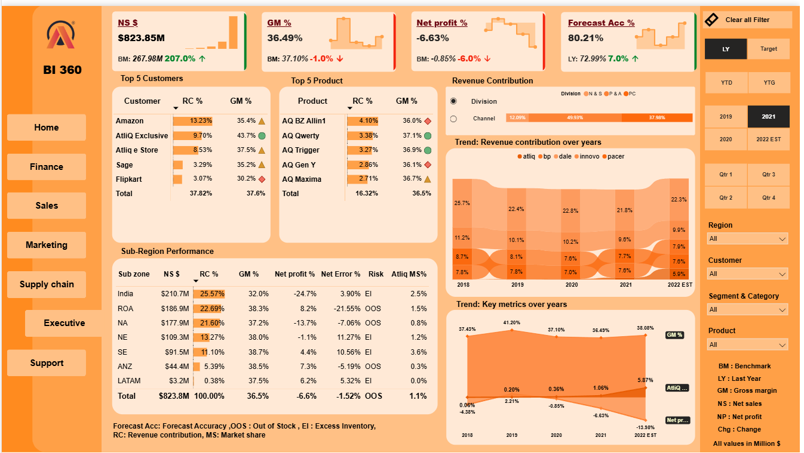

# Business Insights 360: Power BI Dashboard for AtliQ Hardware

A Power BI project that gives AtliQ Hardware insights across **Finance, Sales, Marketing, Supply Chain** and an **Executive View**, built on data stored in MySQL.

**[View the Live Dashboard](https://app.powerbi.com/view?r=eyJrIjoiNzkyN2I3N2ItMjY2Ny00OTg2LWIxM2YtNTIxMDlmNTAzNDNmIiwidCI6ImM2ZTU0OWIzLTVmNDUtNDAzMi1hYWU5LWQ0MjQ0ZGM1YjJjNCJ9&pageName=ReportSectionc62371d7b4c95503a1b6)**

---

## Objective

Support data-driven decision-making across the business, with the aim of increasing sales by 10%.

## Dashboard Preview (FY 2021)

*All values are in millions of dollars. Benchmark (BM) is last year (FY 2020).*

### Finance View

### Sales View

### Marketing View

### Supply Chain View

### Executive View

## Key Insights (FY 2021 vs FY 2020)

**Finance**
- Net sales grew **207% to $823.85M**, but the net loss widened to **-$54.65M (-6.63%)** from -$2.29M.
- **Operating expenses rose 249% to $355.28M**, above gross margin ($300.63M). Gross margin % held steady at 36.49% (37.10% in 2020), so the loss came from costs, not pricing.
- Invoice deductions took about **50% of gross sales**, COGS about 31%, leaving only about **18% as gross margin**.
- Monthly net sales peaked at **$108M in December 2020**, then stayed at about $58M to $61M a month through August 2021.

**Regions**
- **APAC (54% of net sales) lost $33.33M and NA lost $24.32M.** EU (+$2.81M) and LATAM (+$0.20M) were the only profitable regions.
- EU was the fastest-growing region (+260%).
- **India** brought in 25.6% of revenue with a net profit of -24.7%, while **ANZ** (7.3%) and **ROA** (8.2%) were profitable.

**Customers and products**
- **Amazon** is the top customer ($109.03M, 35.40% GM, down from 37.96% in 2020). **AtliQ Exclusive** has the best margin at 43.73%. Flipkart is the weakest among the larger accounts (30.23%).
- The **top 5 customers fell to 37.8% of revenue from 46.2%**, so dependence on a few customers reduced.

**Supply chain**
- **Forecast accuracy improved to 80.21% from 72.99%.** Networking jumped to 90.40% from 52.50%.
- Overall risk is flagged **out of stock**. Amazon, AtliQ e Store, AtliQ Exclusive, Peripherals, Notebook and Accessories show out-of-stock risk, while Networking, Desktop and Storage show excess inventory.

**Trend (Executive View)**
- Gross margin stayed between 36% and 41% from 2018 to the 2022 estimate, but **net profit % fell from 2.21% (2019) to -0.85% (2020) and -6.63% (2021)**.
- AtliQ's market share grew from 0.36% (2020) to 1.06% (2021).
- **Takeaway:** sales growth is strong, but profit is not following. Operating costs and APAC and NA profitability need attention.

## Components

1. **Finance View:** profit and loss statement, margins, expenses and financial trends
2. **Sales View:** customer and product performance, performance matrix, unit economics
3. **Marketing View:** region, segment and category sales and profit overview
4. **Supply Chain View:** forecast accuracy, net error and stock risk by customer and product
5. **Executive View:** top customers and products, revenue contribution, sub-region performance and key metric trends

## Business Terms

| Term | Meaning |
|---|---|
| Gross Price (GP) | Full price of the item before any discounts |
| Pre-invoice Deductions (PID) | Discounts or rebates given before the invoice |
| Net Invoice Sales (NIS) | GP - PID |
| Post-invoice Deductions (POD) | Returns, refunds or other adjustments after the invoice |
| Net Sales (NS) | NIS - POD |
| Manufacturing Cost (MC) | Cost of making the product |
| Freight Cost (FC) | Cost of transporting the product |
| Cost of Goods Sold (COGS) | MC + FC |
| Gross Margin (GM) | NS - COGS |
| Operational Expenses (OE) | Costs of running the business, such as rent, marketing and salaries |
| Net Profit (NP) | NS - COGS - OE |
| YTD / YTG | Year to date / year to go |
| FY | Financial year |

## Tools Used

- **MySQL:** database
- **Power BI:** data analytics and visualisation

## Acknowledgments

Thanks to Hemanand Vadivel, Dhaval Patel and the Codebasics team for the dataset and guidance. Course: [Codebasics](https://codebasics.io/login)

## Contact

**Harishankar** | [LinkedIn](https://lnkd.in/p/gRyZvpRs) | [GitHub](https://github.com/Harishankar97)
